
&nbsp;


&nbsp;&nbsp;


 

<a href="https://github.com/Gustor1/ultimate-travel-agent"></a>

<a href="https://app-vacances-27.vercel.app"></a>

<a href="https://app-vacances-27.vercel.app">Ouvrir l'appli en ligne ↗</a> &nbsp;·&nbsp; <a href="https://github.com/Gustor1/app-vacances-27">Code</a>

<a href="https://github.com/Gustor1/projet-ml-s3"></a>

<a href="https://gustor1.github.io/study-tools/"></a>

<a href="https://gustor1.github.io/study-tools/">Voir tous les outils ↗</a> &nbsp;·&nbsp; <a href="https://gustor1.github.io/techtalk-revision/">Essayer l'atelier d'anglais ↗</a> &nbsp;·&nbsp; <a href="https://github.com/Gustor1/study-tools">Dépôt</a>

 


 

<a href="https://github.com/Gustor1/meteo-time-series"></a>
<a href="https://github.com/Gustor1/meteo-ml-insights"></a>
<a href="https://github.com/Gustor1/analyse-climat-strasbourg"></a>

<a href="https://github.com/Gustor1/apprendre-chinois-mandarin"></a>
<a href="https://github.com/Gustor1/projet-bd70"></a>
<a href="https://github.com/Gustor1/Projet-LP25-A2025"></a>

 

