&nbsp;

&nbsp;&nbsp;

 

<a href="https://app-vacances-27.vercel.app">Open the live app ↗</a> &nbsp;·&nbsp; <a href="https://github.com/Gustor1/app-vacances-27">Code</a>

<a href="https://gustor1.github.io/study-tools/">See all the tools ↗</a> &nbsp;·&nbsp; <a href="https://github.com/Gustor1/study-tools">Repo</a>

 

 

 

