<!-- Portfolio : à ajouter dans la ligne ci-dessous quand il sera en ligne -->

  <a href="https://www.linkedin.com/in/eliott-le-bb24a5363/">LinkedIn</a> &nbsp;·&nbsp;
  <a href="https://github.com/Gustor1?tab=repositories">All repositories</a>

 

Engineering student at **UTBM** (France), on a work-study apprenticeship at **Électricité de Strasbourg**, so half my time is spent in the **energy sector**, where power grids, data and the energy transition meet. I'm into **AI agents**: I write skills, MCP servers and multi-agent workflows, and I work with agents every day. The rest of the time I build web apps that keep working offline.

I also have a soft spot for **China**: its cities, the street life, the metro at rush hour, the Huangpu at night. Two of the projects below came out of that.

🇫🇷 Étudiant ingénieur à l'UTBM en alternance chez Électricité de Strasbourg, dans le secteur de l'énergie. Passionné d'IA et surtout d'agents IA. Je construis des agents, des apps web et des outils local-first, avec un faible pour la Chine et la vie de ses villes.

 

## Selected work

### [Ultimate Travel Agent](https://github.com/Gustor1/ultimate-travel-agent)
An open-source multi-agent toolkit for planning trips you can actually check. It has 14 skills, 12 specialist agents and 9 workflows on top of a deterministic Python core, with an optional MCP server. Every recommendation comes with sources, freshness rules and a budget you can verify. It plans and checks, and never books anything for you.

`Python` `MCP` `Agent Skills` `multi-agent` `local-first` 
🇫🇷 Pack open-source de skills et d'agents pour planifier des voyages réalistes et vérifiables.

### [Détours](https://github.com/Gustor1/app-vacances-27) &nbsp;[live ↗](https://app-vacances-27.vercel.app)
A travel notebook app. It started as a planner for a 2027 trip across China (Shenzhen → Yangshuo → Chongqing → Chengdu → Shanghai) and grew into multi-trip notebooks with day plans, maps, bookings, budget in CNY/EUR and Chinese phrases to copy. The local mode works offline with no account. A Supabase beta adds Google sign-in, sync and shared notebooks with roles for each member.

`React` `TypeScript` `Vite` `Leaflet` `Supabase` `PWA` 
🇫🇷 Carnet de voyage hors-ligne, né d'un voyage en Chine prévu en 2027.

### [Speech under noise](https://github.com/Gustor1/projet-ml-s3)
Machine-learning course project, **Shanghai University × UTBM**, with a team of 6. We asked whether classical denoising helps modern speech models. It doesn't, at least not in real noise. Wiener filtering lowers Whisper's error rate under white noise but **raises it by 8 to 11 %** under pink, street and crowd noise, and it removes the cues that emotion recognition depends on. Our answer was a parallel routing pipeline with multimodal fusion, which brought emotion accuracy up by 20 % relative.

`Python` `Whisper` `Wav2Vec2` `DistilBERT` `DSP` `Docker` 
🇫🇷 Projet de ML : le débruitage classique dégrade la reconnaissance vocale en bruit réel ; architecture parallèle et fusion multimodale.

 

## Activity

Rebuilt every day by a GitHub Action from my contribution calendar.

 

## Also on the shelf

- **Study tools.** Interactive revision sites I built for my courses: [databases & SQL](https://gustor1.github.io/revision-bd70/) · [networking quiz](https://gustor1.github.io/sr71-revision-qcm/) · [networking lab](https://gustor1.github.io/sr71-revision-tp/) · [Java lab](https://gustor1.github.io/revision-tp-java/) · [English final](https://gustor1.github.io/techtalk-revision/)
- **Data & weather.** [Next-day temperature forecasting in Strasbourg](https://github.com/Gustor1/meteo-time-series) · [MeteoInsight](https://github.com/Gustor1/meteo-ml-insights) · [climate analysis](https://github.com/Gustor1/analyse-climat-strasbourg)
- **Learning Mandarin.** [apprendre-chinois-mandarin](https://github.com/Gustor1/apprendre-chinois-mandarin)
- **School projects.** [Warehouse management app, PHP/MariaDB](https://github.com/Gustor1/projet-bd70) · [systems programming in C](https://github.com/Gustor1/Projet-LP25-A2025)

 

## Toolbox

**Languages:** Python · TypeScript · JavaScript · PHP · C · SQL 
**Building:** React · Vite · Supabase · Streamlit · Docker · Vercel 
**AI:** agent skills · MCP · multi-agent orchestration · Hugging Face · Whisper · scikit-learn · Claude Code · Codex

 

One commit at a time.

